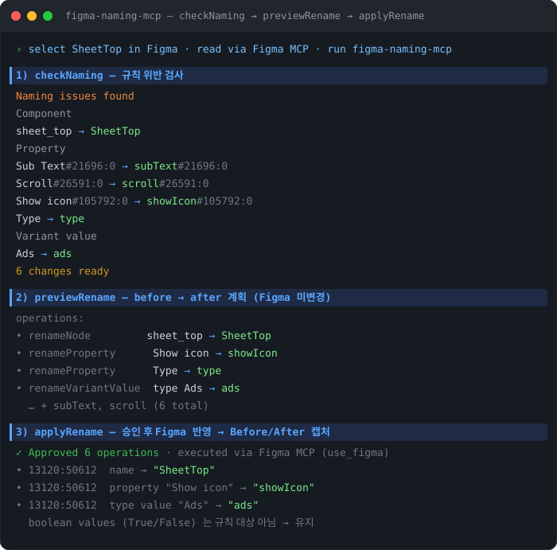

# Figma Naming

Figma 디자인 파일의 네이밍 규칙을 검사하고 정리하는 도구입니다.

디자이너가 반복적으로 확인하던 **Frame · Component · Property · Variant** 네이밍을
검사하고, 변경 후보를 확인한 뒤 적용할 수 있도록 만들었습니다.
두 가지 방식으로 쓸 수 있고, 둘 다 같은 규칙 엔진(`src/`)을 사용합니다.

| 방식 | 이런 분께 | 필요한 것 |
| --- | --- | --- |
| **[Figma 플러그인](#figma-플러그인-빠른-시작)** | Figma 안에서 바로 쓰고 싶은 디자이너 | Figma 데스크톱 앱 |
| **[MCP](#installation)** | Claude Code로 대화하며 정리하고 싶은 분 | Node.js, Claude Code, 공식 Figma MCP |

---

## Figma 플러그인 빠른 시작

### 1. 다운로드

**[⬇️ figma-naming-plugin.zip 다운로드](https://github.com/OmongP/Fimga-naming/releases/latest/download/figma-naming-plugin.zip)**

받은 zip 파일의 압축을 풉니다. 안에 `figma-naming-plugin` 폴더가 있습니다.

```text
figma-naming-plugin/
  manifest.json
  ui.html
  dist/code.js
```

> 압축을 푼 폴더는 지우거나 옮기지 마세요. Figma가 이 위치의 파일을 계속 읽습니다.
> 문서·Applications 같은 고정된 곳에 두는 것을 추천합니다.

### 2. Figma에 등록 (처음 한 번만)

1. **Figma 데스크톱 앱**을 엽니다. (웹 브라우저 버전에서는 개발 플러그인을 불러올 수 없습니다)
2. 아무 디자인 파일이나 열고, 메뉴에서 **Plugins → Development → Import plugin from manifest…** 를 선택합니다.
3. 압축을 푼 폴더의 `manifest.json`을 선택합니다.

이제 **Plugins → Development → Figma Naming** 에 플러그인이 보입니다.

### 3. 사용하기

패널 위쪽 탭에서 **이름 규칙**과 **번호 매기기** 중 하나를 고릅니다.

#### 이름 규칙

1. 정리할 프레임이나 컴포넌트를 선택합니다. (아무것도 선택하지 않으면 **현재 페이지 전체**를 검사합니다)
2. **Plugins → Development → Figma Naming** 을 실행합니다.
3. 패널에서 `before → after` 목록을 확인합니다.
   - 바꾸지 않을 항목은 **체크를 해제**합니다.
   - `GraphStatContainr → GraphStatContainer`처럼 영어 단어 오타로 보이는 항목에는 **오타?** 표시가 붙습니다.
   - `+top`처럼 이름에 들어간 기호(`+`, `&` 등)는 지우고 정리합니다.
   - `Frame 12`처럼 기본 이름인 프레임은 **안에 든 콘텐츠를 보고 이름을 제안**합니다(`Image`, `Title`, `IconText`, `BoxButtonGroup`, 화면 상단·본문·하단이면 `Header`·`MainContent`·`SheetBottom`). 제안을 고치거나 직접 입력할 수 있고, 비워 두면 건너뜁니다.
   - 항목 오른쪽 **↗** 를 누르면 해당 레이어로 이동합니다.
4. **적용**을 누릅니다. 결과가 마음에 들지 않으면 **⌘Z (Ctrl+Z)** 로 되돌릴 수 있습니다.
5. 레이어 선택을 바꿨다면 **다시 검사**를 누릅니다.

#### 번호 매기기

선택한 레이어의 기존 이름을 지우고 **`접두어` + 1, 2, 3 …** 으로 새로 짓습니다. (Ultra Renamer와 같은 방식이고, 번호는 1부터 시작합니다)

1. 이름을 바꿀 프레임들을 캔버스에서 선택합니다. 선택을 바꾸면 목록이 바로 갱신됩니다.
2. **접두어**를 입력합니다. 예: `Screen_` → `Screen_1`, `Screen_2` … (비우면 `1`, `2` …)
3. **순서**를 고릅니다.
   - **가로 먼저**: 왼쪽 → 오른쪽, 그다음 아랫줄
   - **세로 먼저**: 위 → 아래, 그다음 오른쪽 열
   - 위치 차이가 30px 이내인 레이어는 같은 줄로 봅니다.
4. **이름 바꾸기**를 누릅니다.

> 접두어 없이 숫자만 남기면 **이름 규칙** 탭이 "의미 있는 이름이 필요해요"로 표시합니다. 규칙 검사와 같이 쓴다면 접두어를 넣으세요.

### 업데이트

새 버전의 zip을 받아 **기존 폴더에 덮어쓰면** 됩니다. Figma에 다시 등록할 필요는 없습니다.
모든 버전은 [Releases](https://github.com/OmongP/Fimga-naming/releases)에서 볼 수 있습니다.

### 자주 묻는 질문

- **Plugins 메뉴에 Development가 없어요** → 데스크톱 앱인지 확인하세요. 브라우저에서는 보이지 않습니다.
- **플러그인이 사라졌어요** → 압축을 푼 폴더를 옮겼거나 지웠을 수 있습니다. 2단계를 다시 해 주세요.
- **"적용 실패"가 떠요** → 패널에 표시된 오류 문구와 함께 [Issues](https://github.com/OmongP/Fimga-naming/issues)에 남겨 주세요.
- **인터넷 연결이 필요한가요?** → 아니요. 플러그인은 외부로 아무 데이터도 보내지 않습니다.

---

# Figma Naming MCP

Claude Code에서 쓰는 MCP 버전입니다.
`checkNaming → previewRename → applyRename` 3단계로 안전하게 이름을 정리합니다.

## 실행 화면



---

## Naming Rules

| 대상 | 규칙 | 예시 |
| --- | --- | --- |
| Frame | **PascalCase** | `bottom_sheet` → `BottomSheet` |
| Component | **PascalCase** | `sheet_top` → `SheetTop` |
| Property | **camelCase** | `Show icon` → `showIcon` |
| Variant Value | **소문자 시작** | `Selected` → `selected` |
| Boolean Value | **변경하지 않음** | `True / False` 유지 |

복합어의 경우 단순히 첫 글자만 대문자로 바꾸지 않고 **의미 단위로 분리**합니다.
사전(`DEFAULT_DICTIONARY`: bottom, sheet, contents, full, top, ads, box, button, status, bar, text, field, home, dark, mode, service, system, caption, list)으로 처리하며 규칙 인자로 확장할 수 있습니다.

예: `bottomsheet` → `BottomSheet`, `textfield` → `TextField`, `Darkmode` → `darkMode`

### 예외 처리 (기계적 규칙을 적용하면 안 되는 값)

실무에서 그대로 소문자화하면 오히려 깨지는 값들이 있어, 다음은 **변경하지 않습니다**:

| 값 유형 | 예시 | 이유 |
| --- | --- | --- |
| 코드성 ID (구분자 포함) | `SS_001_receipt` | 자체 ID 컨벤션 — `sS_001_...`로 깨짐 |
| 숫자 시작 | `1depth`, `12` | 소문자화 불가 |
| 비라틴(한글 등) | `주민등록번호` | 대소문자 개념 없음 |
| 이미 소문자 시작 | `basic`, `suffix-unit` | 준수 |

- **Variant 값은 "대문자로 시작하는 단순 라틴 단어"일 때만** 정규화합니다 (`Yes→yes`, `Selected→selected`).
- **속성명의 괄호 주석은 제거**한 뒤 케이싱합니다: `Asterisk (별표)` → `asterisk`.
- `Property 1` 같은 Figma 기본 속성명은 케이싱만 되므로(`property1`), 의미 있는 이름(예: `icon`)은 사람이 지정합니다.

### 프레임 네이밍 규칙 (화면 구조)

모든 프레임은 **역할/내용 기반의 의미 있는 PascalCase** 이름을 가집니다. 표준 화면 구조:

```
[Screen]                 예: AssetInformation, CounselingRequestComplete
  StatusBar / TopNavigation   (상단 인스턴스)
  Header
  Title
  MainContent            ← body(본문) 프레임은 항상 MainContent
    TextField / Period / Loans / Image / NoticeList …  (내용 기반 하위 프레임)
  SheetBottom            (하단)
```

- **기본 이름(`Frame 123`)과 숫자만(`1`, `3`)인 프레임은 "의미 있는 이름 필요"로 플래그**됩니다 — 이후 사람/AI가 넣은 이름을 PascalCase로 정규화.
- "body = `MainContent`"는 의미 가이드라인(옛 이름에서 유추 불가)이라 Claude가 지정합니다.
- 인스턴스는 컴포넌트명을 유지합니다.

---

## 주요 기능

### 1. checkNaming

현재 네이밍이 규칙에 맞는지 검사합니다.

```text
Component
sheet_top → SheetTop

Property
Show icon → showIcon
Type → type

Variant value
Selected → selected
```

### 2. previewRename

실제로 변경하기 전에 변경 예정 내용(`before → after`)과 실행용 `operations`를 확인합니다.
이 단계에서는 **Figma의 이름을 변경하지 않습니다.**

```text
3 naming issues found

sheet_top → SheetTop
Show icon → showIcon
Selected → selected
```

### 3. applyRename

확인한 변경사항을 실제로 적용합니다. 실수로 이름이 바뀌지 않도록 **검사 → 미리보기 → 사용자 확인 → 적용** 순서로 구성했습니다.

```text
checkNaming
↓
previewRename
↓
사용자 확인
↓
applyRename
```

`operations`는 3종류이며, 클라이언트(Claude)가 공식 Figma MCP의 `use_figma`로 실행합니다.

| operation | 동작 |
| --- | --- |
| `renameNode` | `node.name = to` |
| `renameProperty` | `componentSet.editComponentProperty(from, { name: to })` |
| `renameVariantValue` | variant 자식 컴포넌트의 `name`을 `prop=value`에서 값만 교체 |

> 이 MCP는 Figma를 직접 건드리지 않고 "이름 규칙"만 판단하는 **결정적(deterministic) 규칙 엔진**입니다.
> 실제 Figma 읽기 / 쓰기 / 캡처는 **공식 Figma MCP**가 담당하며, Claude가 두 MCP를 오케스트레이션합니다.

---

# Installation

## 사전 준비물

- **Node.js 18+** (`node --version`)
- **Claude Code** (CLI 또는 데스크톱 앱)
- **공식 Figma MCP** 연결 — 실제 Figma 읽기/쓰기/캡처를 담당하므로 함께 연결돼 있어야 합니다.

## 1. Repository Clone

Terminal을 열고 아래 명령어를 실행합니다.

```bash
git clone https://github.com/OmongP/Fimga-naming.git
```

프로젝트 폴더로 이동합니다.

```bash
cd Fimga-naming
```

## 2. Package 설치

```bash
npm install
```

설치가 완료되면 MCP 실행에 필요한 패키지가 준비됩니다.

## 3. 테스트 (규칙 엔진 검증)

```bash
npm test
```

## 4. Claude Code에 MCP 등록

프로젝트 경로를 확인합니다.

```bash
pwd
```

예:

```text
/Users/username/Documents/Fimga-naming
```

Claude Code에 MCP를 등록합니다. (현재 폴더 기준 절대경로로 등록하면 편리합니다.)

```bash
claude mcp add figma-naming -- node "$(pwd)/index.js"
```

> `/Users/username/...` 부분은 자신의 실제 프로젝트 경로로 변경해주세요.

## 5. MCP 연결 확인

Claude Code를 실행합니다.

```bash
claude
```

Claude Code에서 `/mcp` 를 입력했을 때 아래처럼 표시되면 연결 완료입니다.
공식 Figma MCP도 함께 연결됐는지 확인하세요.

```text
figma-naming
connected
```

---

# Usage

Claude Code에서 정리할 **컴포넌트 / 프레임을 Figma에서 선택**한 뒤 아래와 같이 요청할 수 있습니다.

### 네이밍 검사

```text
이 Figma 컴포넌트의 네이밍 규칙을 검사해줘.
figma-naming MCP의 checkNaming을 사용해줘.
```

### 변경 예정 확인

```text
네이밍 변경 예정 결과를 보여줘.
아직 실제 이름은 수정하지 마.
```

### 실제 적용

```text
확인했어.
위 네이밍 변경사항을 적용해줘.
```

이름 변경이라 Figma에서 `Cmd+Z`로 되돌릴 수 있습니다.

---

# Example

### Before

```text
Frame
bottom_sheet

Component
sheet_top

Property
Show icon
Sub Text

Variant
Selected
```

### After

```text
Frame
BottomSheet

Component
SheetTop

Property
showIcon
subText

Variant
selected
```

Boolean 값인 `True`, `False`는 변경하지 않습니다.

---

# Why I Made This

Figma MCP를 활용해 디자인을 코드로 구현하는 과정에서, AI와 개발자가 디자인 구조를 이해하려면
디자인 자체뿐 아니라 **일관된 네이밍**도 중요하다는 점을 확인했습니다.

하지만 실제 업무에서는 작업 과정에서 네이밍 규칙이 깨지거나, 작업자마다 다른 방식으로 이름을 작성하는 경우가 있습니다.

이 MCP는 사람이 반복적으로 확인하던 네이밍 작업을 자동으로 검사하고, 동일한 규칙으로 정리하기 위해 만들었습니다.
특히 디자인 시스템을 사용하는 팀에서 **디자이너 · 개발자 · AI가 동일한 구조를 이해**하는 데 도움이 되는 것을 목표로 합니다.

---

# Recommended Workflow

```text
Figma Design
      ↓
Figma MCP        (선택 노드 읽기)
      ↓
Claude Code      (오케스트레이터)
      ↓
Figma Naming MCP (규칙 검사·제안)
      ↓
Naming Check → Preview → Apply
```

---

# Development

현재 적용된 주요 규칙:

```text
Component / Frame     → PascalCase (복합어 분리)
Property              → camelCase
Variant string value  → lowercase first letter
Boolean value         → unchanged
```

프로젝트 구조:

```text
index.js              MCP 서버 (stdio, 도구 4개)
src/conventions.js    케이스 변환·검증, 복합어 분리, 기본 이름 감지
src/naming.js         검사·리네임 계획·결과 화면 포맷
test/naming.test.js   규칙 엔진 테스트 (11개)
examples/demo.mjs     checkNaming→previewRename→applyRename 실행 데모
docs/demo.svg         실행 화면 캡처
```

Test:

```bash
npm test
```

End-to-end 데모 실행:

```bash
node examples/demo.mjs
```

---


## 플러그인 개발

```bash
npm run build:plugin   # figma-plugin/dist/code.js 빌드
npm run pack:plugin    # 배포용 figma-naming-plugin.zip 생성
```

`src/` 규칙이나 `figma-plugin/src/` 코드를 고친 뒤에는 `npm run build:plugin`으로 다시 빌드합니다.
저장소를 clone했다면 `figma-plugin/manifest.json`을 바로 Figma에 불러와 테스트할 수 있습니다.

새 버전 배포는 태그를 올리면 GitHub Actions가 zip을 만들어 Release에 첨부합니다.

```bash
git tag v1.0.0 && git push origin v1.0.0
```

# Future

- 팀별 Naming Dictionary
- 디자인시스템 컴포넌트 규칙 검사
- 잘못된 Variant 구조 탐지
- Figma Layer Naming 검사
- 사내 디자인시스템 전용 MCP
- npm 또는 Remote MCP 형태의 팀 배포

---

## License

See [`LICENSE`](LICENSE). (ISC)
